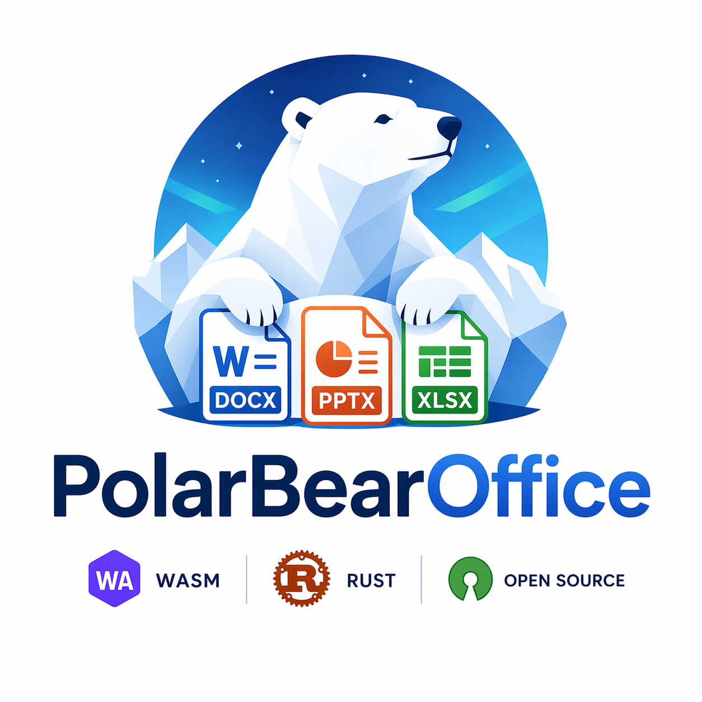
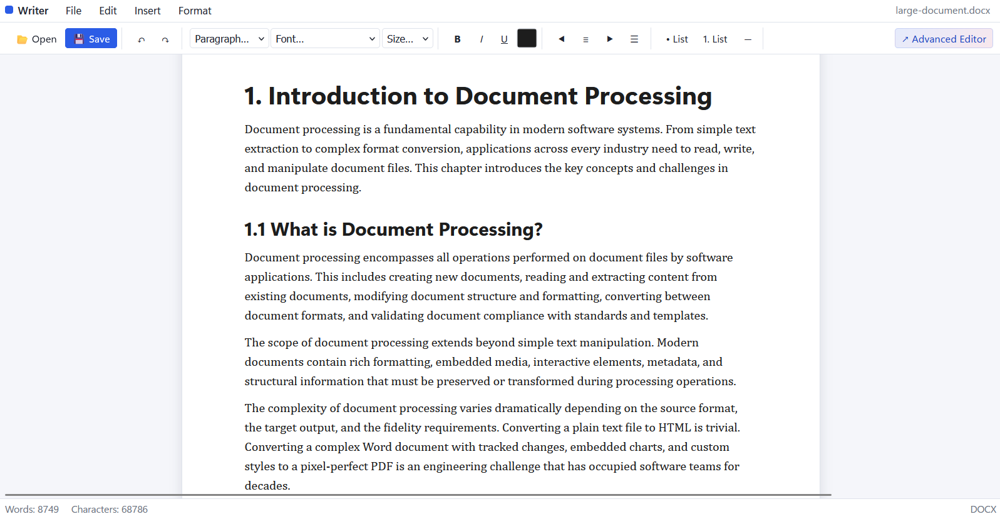
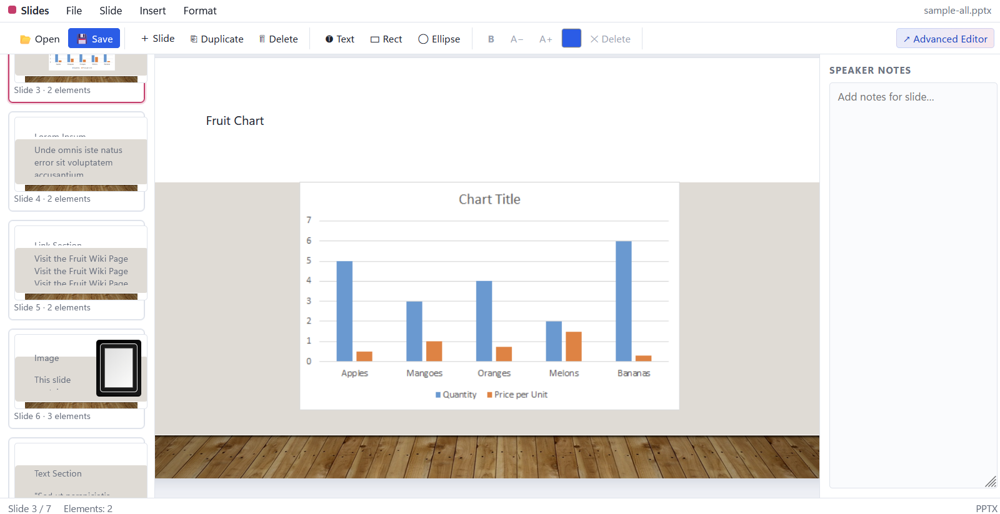
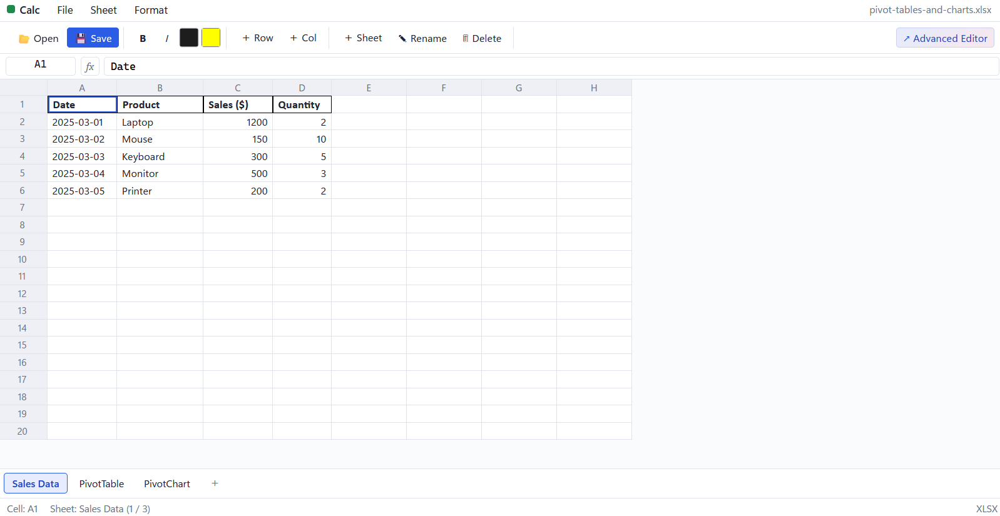

# 🐻‍❄️ PolarBearOffice

<table>
	<tr>
		<td width="240" valign="top">
			
		</td>
		<td valign="middle">
			<strong>Open-source office suite (experimental)</strong> — a mini office application built with <strong>Rust</strong>, a local <strong>Axum</strong> server, and a <strong>React</strong> UI.
			<p>PolarBearOffice opens, edits, and saves Word, Excel, and PowerPoint documents using a Rust document engine behind a local HTTP API.</p>
			<p>Very minimal implementation for the default editor. Only supports basic rendering. <a href="https://github.com/ONLYOFFICE">OnlyOffice</a> wrapper for advanced editing - <code>Planned</code>.</p>
		</td>
	</tr>
</table>

## Features

| App | Format | Status |
|-----|--------|--------|
| 📝 **Writer** | `.docx` (WordprocessingML) | Open/save paragraphs, runs, headings, alignment, basic styles |
| 📊 **Slides** | `.pptx` (PresentationML) | Open/save slides with text boxes (position, size, bold, size) |
| 📈 **Calc** | `.xlsx` (SpreadsheetML) | Open/save sheets, cells, shared strings (text / number / boolean) |

## Screenshots

<table>
	<tr>
		<td align="center" width="33%">
			
			<br />
			<strong>Writer</strong>
		</td>
		<td align="center" width="33%">
			
			<br />
			<strong>Slides</strong>
		</td>
		<td align="center" width="33%">
			
			<br />
			<strong>Calc</strong>
		</td>
	</tr>
</table>

## Architecture

- **Rust core** — canonical document models plus OOXML parsing and writing
- **Axum server** — local API that exposes the Rust core to the UI
- **React UI** — lightweight browser-based editors for each app
- **Optional WASM crate** — kept as an alternate integration path, not the current UI runtime

See [docs/ARCHITECTURE.md](docs/ARCHITECTURE.md) for full details.

## Quick Start

### Prerequisites

- [Rust](https://rustup.rs/) (stable)
- [Node.js](https://nodejs.org/) (v20+)

### Build & Run

```bash
# Run the Rust test suite (round-trips + fixture files)
cargo test --workspace

# Install UI dependencies
cd ui
npm install

# Start the UI dev server
npm run dev                 # → http://localhost:5173

# Start the API server
cargo run -p pbo-server     # → http://localhost:3001
```

The current UI talks to `pbo-server` over `/api`. Vite proxies those calls to
`http://localhost:3001` in development.
